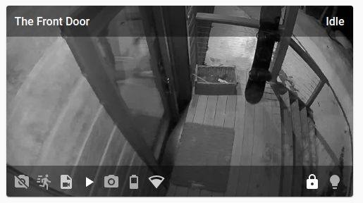

# lovelace-hass-arlo

Lovelace card designed specifically for the [AArlo Integration](https://github.com/twrecked/hass-aarlo).

## Version 0.4

### Features
It provides:
* Motion and sound notifications.
* Access to the camera library recordings.
* Live streaming with smart, Arlo-direct, and Home Assistant proxy modes.
* Support for doorbell and door opening notifications.
* Support for toggling lights and locks during streaming.
* Card picker UI discovery, native Visual Editor support, and Home Assistant Sections / Grid layout support.

## Example

## Documentation
See [hass-aarlo](https://github.com/twrecked/hass-aarlo/blob/master/README.md) for full documentation.
